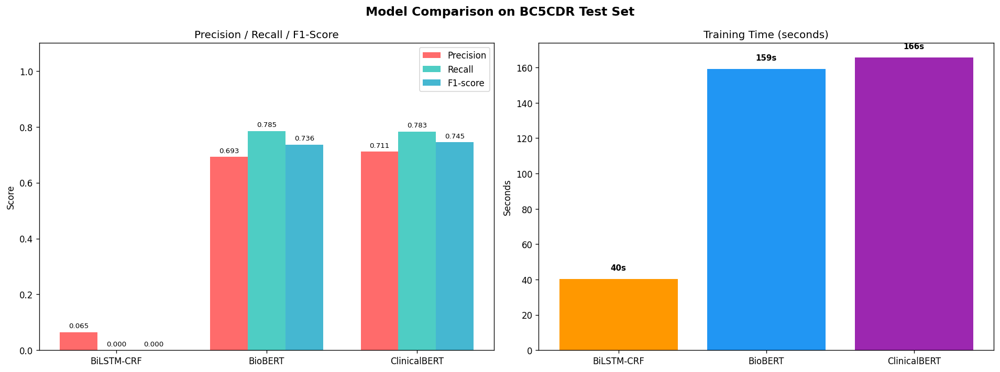
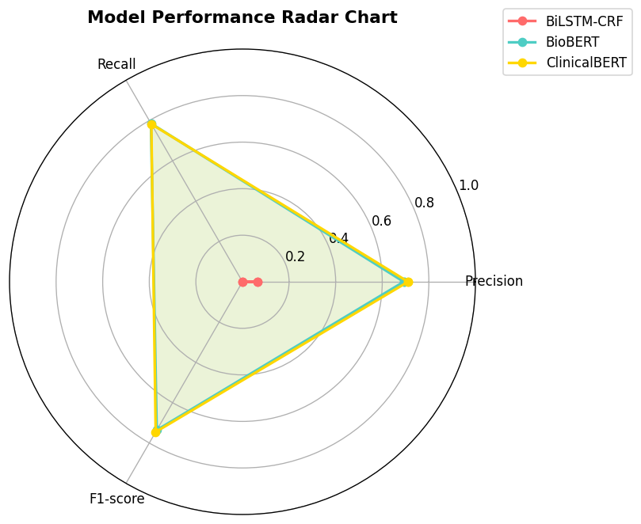
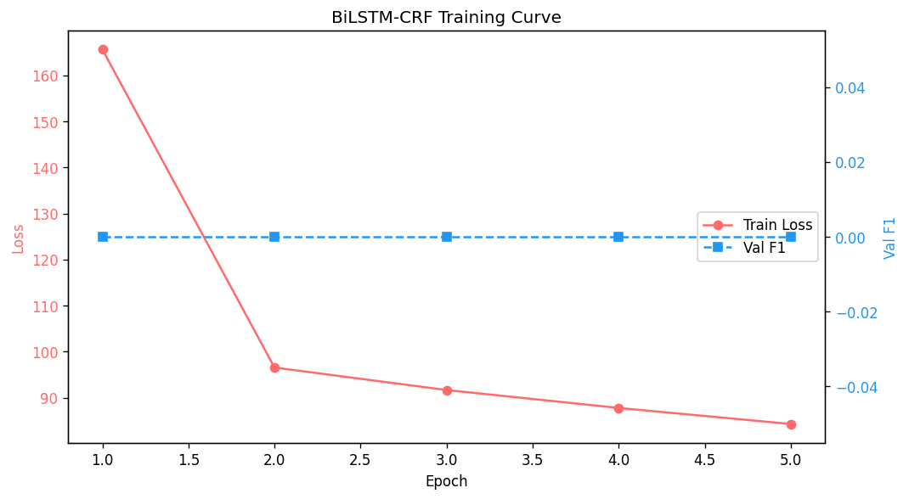
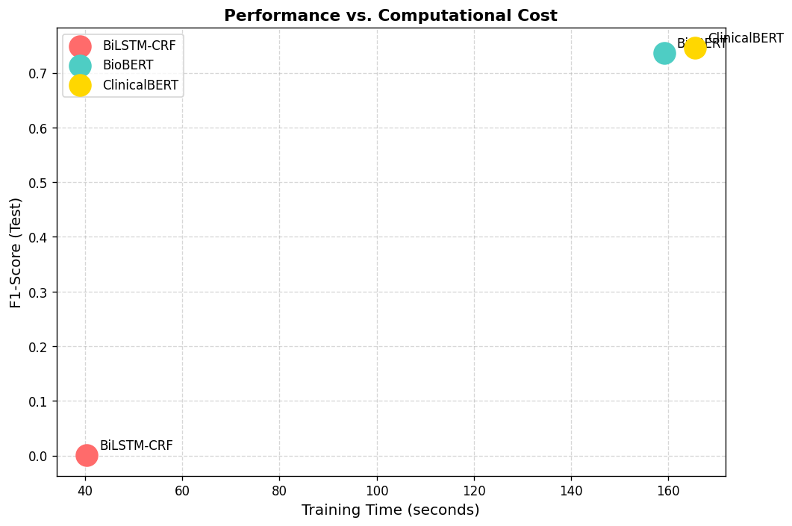

# Biomedical Named Entity Recognition on BC5CDR

Comparison of three sequence labeling models for recognising **Chemical** and **Disease** entities in PubMed abstracts, using BIO tagging.

| Model | Architecture |
|---|---|
| BiLSTM-CRF | Bidirectional LSTM with a CRF output layer (baseline, trained from scratch) |
| BioBERT | `dmis-lab/biobert-base-cased-v1.1`, fine-tuned (pre-trained on PubMed) |
| ClinicalBERT | `emilyalsentzer/Bio_ClinicalBERT`, fine-tuned (pre-trained on MIMIC-III) |

## Dataset

[BC5CDR](https://huggingface.co/datasets/masaenger/bc5cdr) (BioCreative V Chemical-Disease Relation): 500 train / 500 validation / 500 test documents.

Labels: `O`, `B-Chemical`, `I-Chemical`, `B-Disease`, `I-Disease`.

## Results (test set)

Fill this table from `results/ner_results_summary.csv`.

| Model | Precision | Recall | F1 | Train time (s) |
|---|---|---|---|---|
| BiLSTM-CRF | - | - | - | - |
| BioBERT | - | - | - | - |
| ClinicalBERT | - | - | - | - |






## How to run

1. Open `NER_Medical_Project2_clean.ipynb` in Kaggle or Colab.
2. Enable a GPU (and Internet on Kaggle).
3. Run all cells.

Locally:

```bash
pip install -r requirements.txt
jupyter notebook NER_Medical_Project2_clean.ipynb
```

## Main findings

- Transformer models clearly outperform the BiLSTM-CRF on BC5CDR.
- Domain-specific pre-training matters for biomedical text.
- Trade-off: the BiLSTM-CRF trains fastest but scores lowest; the transformers need a GPU and give a much better F1.
# biomedical-ner-biobert-clinicalbert
